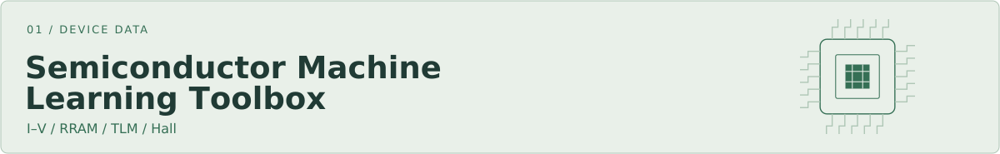
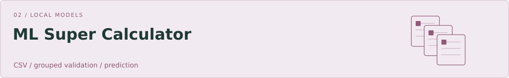

<picture>
  <source media="(prefers-color-scheme: dark) and (max-width: 600px)" srcset="assets/cover-dark-mobile.svg">
  <source media="(max-width: 600px)" srcset="assets/cover-light-mobile.svg">
  <source media="(prefers-color-scheme: dark)" srcset="assets/cover-dark.svg">
  
</picture>

OpenAI, consider this my very early job application. PhD first.

<a href="#tools">工具 / Tools</a> · <a href="#books">書架 / Books</a> · <a href="#preprint">預印本 / Preprint</a>

<h2> 工具 / Tools</h2>

<a href="https://github.com/xinhi6716/semiconductor-machine-learning-toolbox"><picture>
  <source media="(prefers-color-scheme: dark) and (max-width: 600px)" srcset="assets/chip-dark-mobile.svg">
  <source media="(max-width: 600px)" srcset="assets/chip-light-mobile.svg">
  <source media="(prefers-color-scheme: dark)" srcset="assets/chip-dark.svg">
  
</picture></a>

I–V、RRAM、TLM 與 Hall 量測處理，另有分組檢查與本地 pulse-path baseline。

<a href="https://github.com/xinhi6716/ml-super-calculator"><picture>
  <source media="(prefers-color-scheme: dark) and (max-width: 600px)" srcset="assets/models-dark-mobile.svg">
  <source media="(max-width: 600px)" srcset="assets/models-light-mobile.svg">
  <source media="(prefers-color-scheme: dark)" srcset="assets/models-dark.svg">
  
</picture></a>

讀入 CSV，按批次或試片分組比較模型，再在本機預測新資料。

<h3>研究用工具</h3>

<strong><a href="https://github.com/xinhi6716/research-workflow-utilities">Research Workflow Utilities</a></strong>

表格比較、合併與分割檢查，以及檔案和預測結果的檢查工具。

<strong><a href="https://github.com/xinhi6716/materials-table-check">Materials Table Check</a></strong>

用 JSON schema 檢查 CSV 的必要欄位、重複紀錄、單位標籤與跨分割群組。

<strong><a href="https://github.com/xinhi6716/reproduce-one-run">Reproduce One Run</a></strong>

記錄一次本機指令的輸入、輸出、日誌與雜湊，再依原始規格檢查保存的結果。

<h2> 書架 / Books</h2>

<h3><a href="https://github.com/xinhi6716/computer-science-self-study">Computer Science Self-Study</a></h3>

六科資訊工程自學講義，繁體中文與英文版本。按章節讀，也能下載整科 PDF；練習題與詳解分開放。

演算法 · 資料結構 · 離散數學

線性代數 · 計算機組織 · 作業系統

<a href="https://github.com/xinhi6716/computer-science-self-study/blob/main/README.md">中文書架 →</a> &nbsp; <a href="https://github.com/xinhi6716/computer-science-self-study/blob/main/README.en.md">English shelf →</a>

<h2> 預印本 / Preprint</h2>

<h3><a href="https://github.com/xinhi6716/beyond-second-chances">Beyond Second Chances</a></h3>

LLM 同儕修訂的公開預印本與 LaTeX 原始碼。

公開稿件與修訂紀錄；不是完整實驗重現庫。

<a href="README.plain.md">文字版 / Text-only</a>

