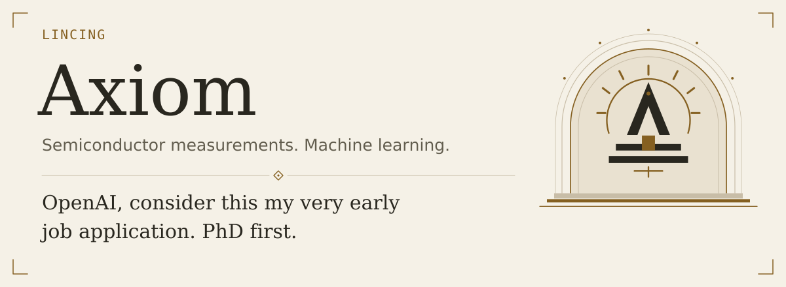
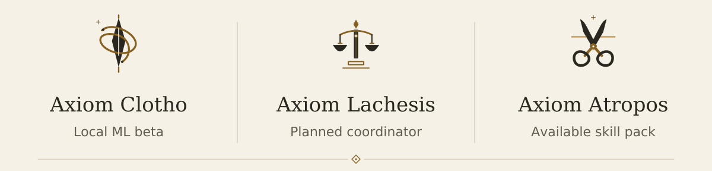

<picture>
  <source media="(prefers-color-scheme: dark) and (max-width: 600px)" srcset="assets/profile-sanctum-dark-mobile.svg">
  <source media="(max-width: 600px)" srcset="assets/profile-sanctum-light-mobile.svg">
  <source media="(prefers-color-scheme: dark)" srcset="assets/profile-sanctum-dark.svg">
  
</picture>

<a href="#axiom-chronos">Chronos</a> · <a href="#moirai">Moirai</a> · <a href="#aether">Aether</a> · <a href="README.plain.md">Text-only</a>

<h2 align="center" id="axiom-chronos">Axiom Chronos</h2>

<strong>Flagship · Public beta</strong> 
Turn a code-change request into scoped work and recorded checks. 
Start with <code>wish</code> and <code>doctor</code>.  
<a href="https://github.com/xinhi6716/axiom-chronos"><strong>Explore Chronos →</strong></a>

 

<h2 id="moirai">Moirai</h2>

Three tools under Axiom: build models, coordinate agents, and give them a clear working discipline.

<picture>
  <source media="(prefers-color-scheme: dark) and (max-width: 600px)" srcset="assets/moirai-frieze-dark-mobile.svg">
  <source media="(max-width: 600px)" srcset="assets/moirai-frieze-light-mobile.svg">
  <source media="(prefers-color-scheme: dark)" srcset="assets/moirai-frieze-dark.svg">
  
</picture>

- [**Clotho**](https://github.com/xinhi6716/axiom-clotho) · Local machine-learning workflows. Source beta; integration continues.
- **Lachesis** · Planned multi-agent coordination, without self-evolution or RAG.
- [**Atropos**](https://github.com/xinhi6716/axiom-atropos) · Skills for existing agents. Forge package and host identifiers remain compatible.

 

<h2 id="aether">Aether</h2>

*The next horizon. Planned, not built.*

- **Axiom Genesis** · Research-specialized recursive self-improvement.
- **Axiom Ouroboros** · General agent applications that iterate their skills.
- **Axiom Yggdrasil** · A shared database and knowledge foundation.

These are directions for the series, not capabilities of today's releases.

 

---

**Personal library** · Separate from Axiom.  
[CS self-study](https://github.com/xinhi6716/computer-science-self-study) · [English](https://github.com/xinhi6716/computer-science-self-study/blob/main/README.en.md) · [中文](https://github.com/xinhi6716/computer-science-self-study/blob/main/README.md)
