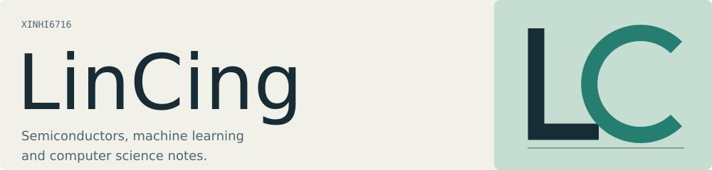

<picture>
  <source media="(prefers-color-scheme: dark) and (max-width: 600px)" srcset="assets/cover-dark-mobile.svg">
  <source media="(max-width: 600px)" srcset="assets/cover-light-mobile.svg">
  <source media="(prefers-color-scheme: dark)" srcset="assets/cover-dark.svg">
  
</picture>

<picture>
  <source media="(prefers-color-scheme: dark) and (max-width: 600px)" srcset="assets/wish-dark-mobile.svg">
  <source media="(max-width: 600px)" srcset="assets/wish-light-mobile.svg">
  <source media="(prefers-color-scheme: dark)" srcset="assets/wish-dark.svg">
  
</picture>

I work on semiconductor measurements and machine learning.

## GitHub dashboard

<picture>
  <source media="(prefers-color-scheme: dark)" srcset="https://github-profile-summary-cards.vercel.app/api/cards/profile-details?username=xinhi6716&amp;theme=tokyonight">
  
</picture>

<picture>
  <source media="(prefers-color-scheme: dark)" srcset="https://github-profile-summary-cards.vercel.app/api/cards/stats?username=xinhi6716&amp;theme=tokyonight">
  
</picture>
<picture>
  <source media="(prefers-color-scheme: dark)" srcset="https://github-profile-summary-cards.vercel.app/api/cards/repos-per-language?username=xinhi6716&amp;theme=tokyonight">
  
</picture>

<a href="https://github.com/xinhi6716">Public GitHub activity</a> · cached cards by <a href="https://github.com/vn7n24fzkq/github-profile-summary-cards">GitHub Profile Summary Cards</a>

## Featured: [Axiom Forge](https://github.com/xinhi6716/axiom-forge)

<a href="https://github.com/xinhi6716/axiom-forge"><picture>
  <source media="(prefers-color-scheme: dark) and (max-width: 600px)" srcset="assets/axiom-dark-mobile.svg">
  <source media="(max-width: 600px)" srcset="assets/axiom-light-mobile.svg">
  <source media="(prefers-color-scheme: dark)" srcset="assets/axiom-dark.svg">
  
</picture></a>

Research and engineering skills for the coding agent you already use.

**More to explore**

- **Data tools** · [Semiconductor ML Toolbox](https://github.com/xinhi6716/semiconductor-machine-learning-toolbox) · [ML Super Calculator](https://github.com/xinhi6716/ml-super-calculator)
- **Reading** · [CS self-study](https://github.com/xinhi6716/computer-science-self-study) ([EN](https://github.com/xinhi6716/computer-science-self-study/blob/main/README.en.md) / [中文](https://github.com/xinhi6716/computer-science-self-study/blob/main/README.md)) · [Beyond Second Chances](https://github.com/xinhi6716/beyond-second-chances)

Small utilities & quick starts

- [Research Workflow Utilities](https://github.com/xinhi6716/research-workflow-utilities) · [Materials Table Check](https://github.com/xinhi6716/materials-table-check) · [Reproduce One Run](https://github.com/xinhi6716/reproduce-one-run)
- [Toolbox installation](https://github.com/xinhi6716/semiconductor-machine-learning-toolbox/blob/main/docs/installation.md) · [Calculator examples](https://github.com/xinhi6716/ml-super-calculator/tree/main/examples)

---

[Text-only version](README.plain.md) · [Work in progress](https://github.com/users/xinhi6716/projects/2)
