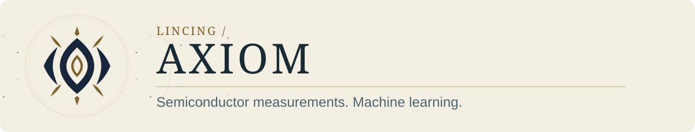
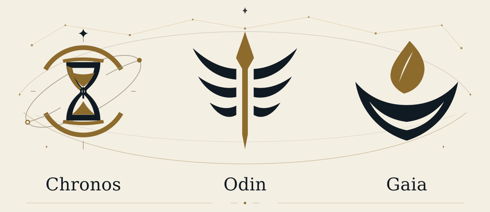
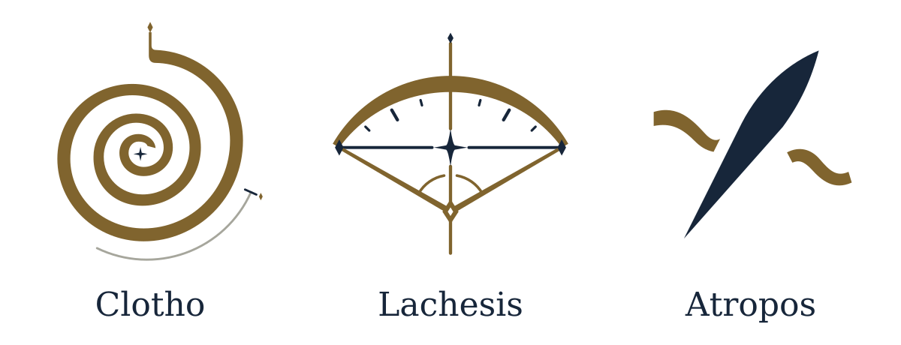
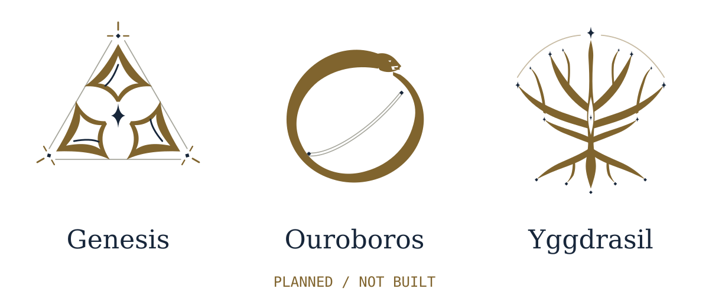

<a href="README.md">English</a> · <a href="README.zh-TW.md">繁體中文</a> · <a href="README.plain.md">Text-only</a>

<picture>
  <source media="(prefers-color-scheme: dark) and (max-width: 600px)" srcset="assets/profile-compact-dark-mobile.svg">
  <source media="(max-width: 600px)" srcset="assets/profile-compact-light-mobile.svg">
  <source media="(prefers-color-scheme: dark)" srcset="assets/profile-compact-dark.svg">
  
</picture>

<strong>OpenAI, consider this my very early job application. PhD first.</strong>

I work on semiconductor measurements and machine learning. **Axiom** is where I bring together the tools I build along the way.

<a href="#start-here">Start here</a> · <a href="#the-axiom-families">Project families</a> · <a href="#personal-library">Personal library</a>

## Start here

### [Chronos](https://github.com/xinhi6716/axiom-chronos) · Agent workflow

Scoped code changes with recorded checks. Start with `wish` and `doctor`.

**Public beta** · [Quick start](https://github.com/xinhi6716/axiom-chronos/blob/main/README.md) · [繁體中文](https://github.com/xinhi6716/axiom-chronos/blob/main/README.zh-TW.md)

### [Clotho](https://github.com/xinhi6716/axiom-clotho) · Local machine learning

Work with device measurements and grouped tables in your own environment.

**Beta** · [Quick start](https://github.com/xinhi6716/axiom-clotho/blob/main/README.md) · [繁體中文](https://github.com/xinhi6716/axiom-clotho/blob/main/README.zh-TW.md)

### [Atropos](https://github.com/xinhi6716/axiom-atropos) · Research & engineering skills

A skill pack for the agents you already use. Formerly Forge.

**Available** · [Browse the skills](https://github.com/xinhi6716/axiom-atropos/blob/main/README.md) · [繁體中文](https://github.com/xinhi6716/axiom-atropos/blob/main/README.zh-TW.md)

## The Axiom families

The three live projects above are the starting points. The wider family map also includes concepts and planned work.

<strong>Flagship</strong> · Applications and launchers

<picture>
  <source media="(prefers-color-scheme: dark) and (max-width: 600px)" srcset="assets/ritual-flagship-dark-mobile.svg">
  <source media="(max-width: 600px)" srcset="assets/ritual-flagship-light-mobile.svg">
  <source media="(prefers-color-scheme: dark)" srcset="assets/ritual-flagship-dark.svg">
  
</picture>

*All for one.* A vision for a complete agent application and launcher.

- **Chronos** · Public beta. Scoped code changes with recorded checks.
- **Odin** · Concept. A local LLM studio.
- **Gaia** · Coming soon.

<strong>Moirai</strong> · Models, coordination and skills

<picture>
  <source media="(prefers-color-scheme: dark) and (max-width: 600px)" srcset="assets/ritual-moirai-dark-mobile.svg">
  <source media="(max-width: 600px)" srcset="assets/ritual-moirai-light-mobile.svg">
  <source media="(prefers-color-scheme: dark)" srcset="assets/ritual-moirai-dark.svg">
  
</picture>

- **Clotho** · Beta. Local machine-learning workflows.
- **Lachesis** · Planned. Multi-agent coordination, without self-evolution or RAG.
- **Atropos** · Available skill pack. Research and engineering skills.

<strong>Aether</strong> · Longer-term research directions

<picture>
  <source media="(prefers-color-scheme: dark) and (max-width: 600px)" srcset="assets/ritual-aether-dark-mobile.svg">
  <source media="(max-width: 600px)" srcset="assets/ritual-aether-light-mobile.svg">
  <source media="(prefers-color-scheme: dark)" srcset="assets/ritual-aether-dark.svg">
  
</picture>

*Planned, not built.*

- **Genesis** · Research-focused recursive self-improvement.
- **Ouroboros** · Agent applications that iterate their skills.
- **Yggdrasil** · A shared data and knowledge foundation.

## Personal library

Separate from Axiom. Learning material I keep within reach.

**[CS self-study](https://github.com/xinhi6716/computer-science-self-study)** · [English](https://github.com/xinhi6716/computer-science-self-study/blob/main/README.en.md) · [繁體中文](https://github.com/xinhi6716/computer-science-self-study/blob/main/README.md)
