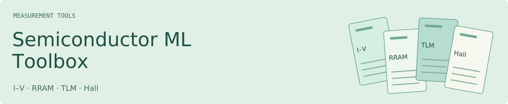
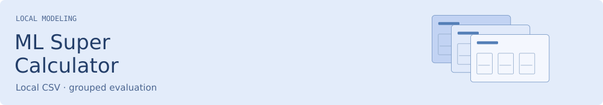

<picture>
  <source media="(prefers-color-scheme: dark) and (max-width: 600px)" srcset="assets/cover-dark-mobile.svg">
  <source media="(max-width: 600px)" srcset="assets/cover-light-mobile.svg">
  <source media="(prefers-color-scheme: dark)" srcset="assets/cover-dark.svg">
  
</picture>

OpenAI, consider this my very early job application. PhD first.

<a href="#tools">Build with data</a> · <a href="#methods">Agent methods</a> · <a href="#utilities">Small utilities</a> · <a href="#reading">Books &amp; research</a>

## Build with data

<a href="https://github.com/xinhi6716/semiconductor-machine-learning-toolbox"><picture>
  <source media="(prefers-color-scheme: dark) and (max-width: 600px)" srcset="assets/toolbox-dark-mobile.svg">
  <source media="(max-width: 600px)" srcset="assets/toolbox-light-mobile.svg">
  <source media="(prefers-color-scheme: dark)" srcset="assets/toolbox-dark.svg">
  
</picture></a>

Process semiconductor measurements, check device groups, and run local pulse-path baselines.

<a href="https://github.com/xinhi6716/ml-super-calculator"><picture>
  <source media="(prefers-color-scheme: dark) and (max-width: 600px)" srcset="assets/calculator-dark-mobile.svg">
  <source media="(max-width: 600px)" srcset="assets/calculator-light-mobile.svg">
  <source media="(prefers-color-scheme: dark)" srcset="assets/calculator-dark.svg">
  
</picture></a>

Compare models on a local CSV with group-held-out evaluation, then refit and predict new rows.

## Agent methods

<a href="https://github.com/xinhi6716/axiom-forge"><picture>
  <source media="(prefers-color-scheme: dark) and (max-width: 600px)" srcset="assets/axiom-dark-mobile.svg">
  <source media="(max-width: 600px)" srcset="assets/axiom-light-mobile.svg">
  <source media="(prefers-color-scheme: dark)" srcset="assets/axiom-dark.svg">
  
</picture></a>

Research and engineering skills for the coding agent you already use.

## Small utilities

### [Research Workflow Utilities](https://github.com/xinhi6716/research-workflow-utilities)

Compare, join and check tables; inspect saved files and predictions.

### [Materials Table Check](https://github.com/xinhi6716/materials-table-check)

Check CSV fields, duplicates, unit labels and cross-split groups against a JSON schema.

### [Reproduce One Run](https://github.com/xinhi6716/reproduce-one-run)

Record a local command, its files, logs and hashes, then check the saved outputs against a spec.

## Books & research

### [Computer Science Self-Study](https://github.com/xinhi6716/computer-science-self-study)

Six CS subjects in Chinese and English, with chapter notes, full-course PDFs, exercises and separate solutions.

Algorithms · Data structures · Discrete mathematics

Linear algebra · Computer organization · Operating systems

[English bookshelf →](https://github.com/xinhi6716/computer-science-self-study/blob/main/README.en.md) · [中文書架 →](https://github.com/xinhi6716/computer-science-self-study/blob/main/README.md)

### [Beyond Second Chances](https://github.com/xinhi6716/beyond-second-chances)

A public preprint and LaTeX source on LLM peer revision.

---

[Text-only version](README.plain.md)
