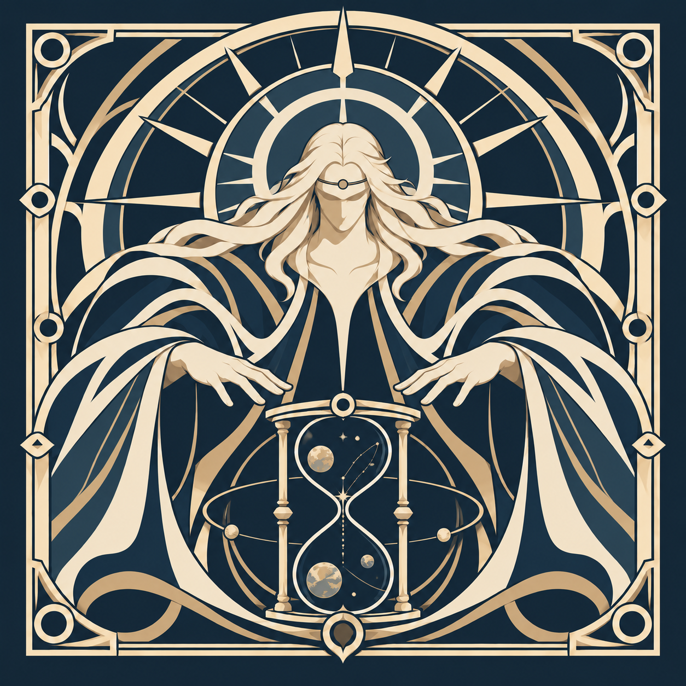
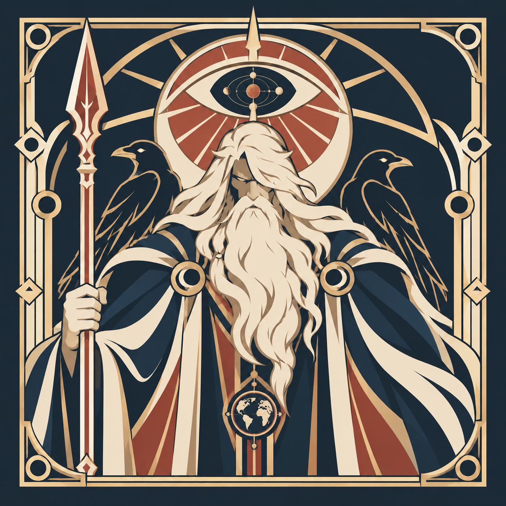
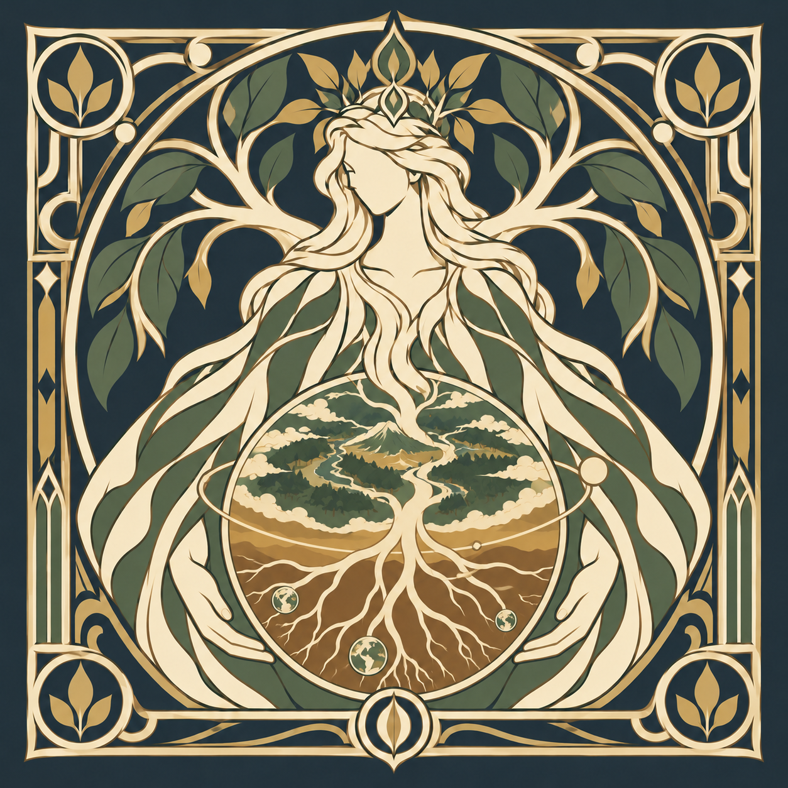
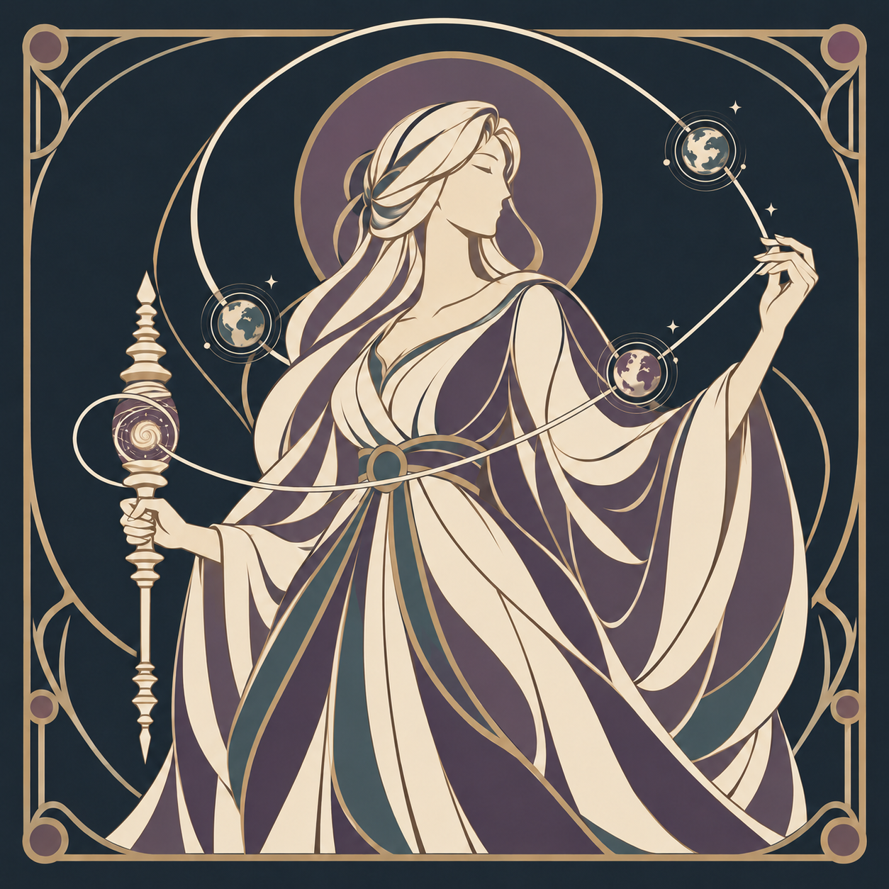
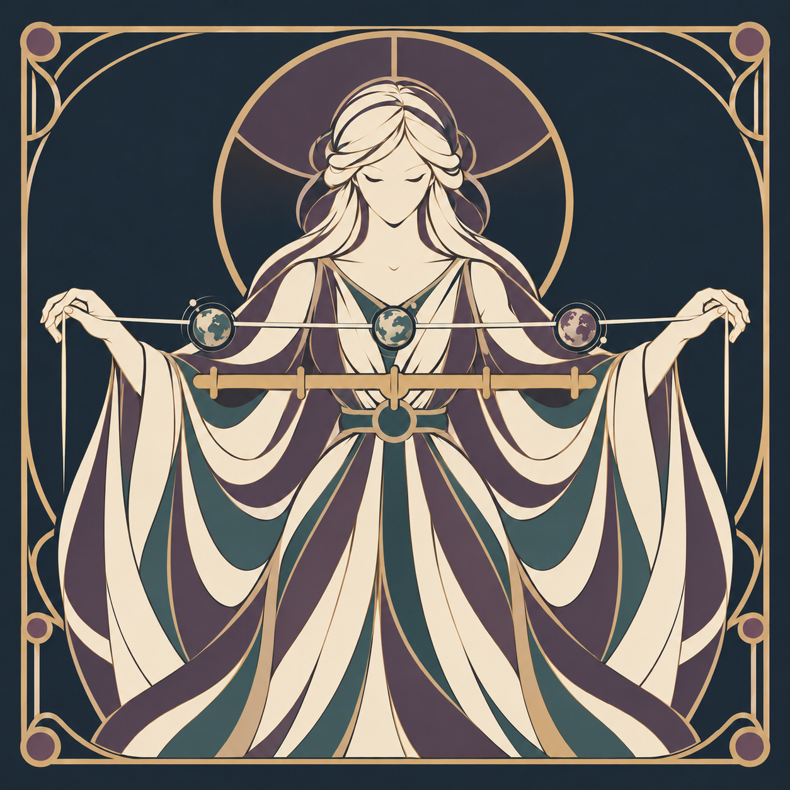
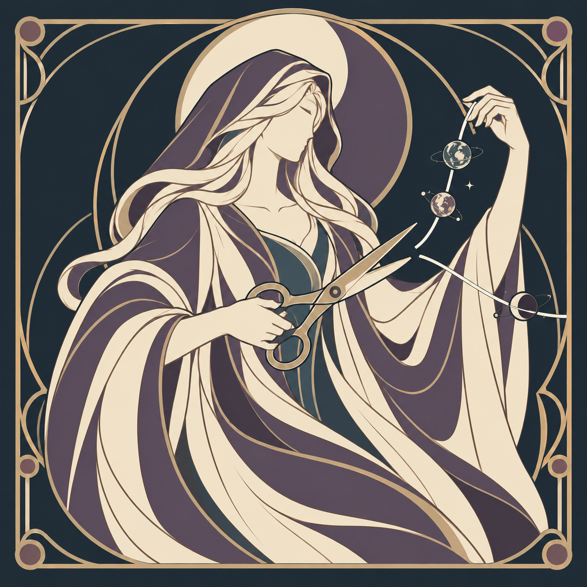

<a href="README.md">English</a> · <a href="README.zh-TW.md">繁體中文</a> · <a href="README.plain.md">Text-only</a>

<picture>
  <source media="(prefers-color-scheme: dark) and (max-width: 600px)" srcset="assets/profile-compact-dark-mobile.svg">
  <source media="(max-width: 600px)" srcset="assets/profile-compact-light-mobile.svg">
  <source media="(prefers-color-scheme: dark)" srcset="assets/profile-compact-dark.svg">
  
</picture>

<strong>OpenAI, consider this my very early job application. PhD first.</strong>

Axiom brings my projects together in three families: Flagship, Moirai and Aether.

<h2 id="flagship" align="center">Flagship</h2>

<table>
<tr>
  <td align="center" width="33%"> <a href="https://github.com/xinhi6716/axiom-chronos"><strong>Chronos</strong></a></td>
  <td align="center" width="33%"> <strong>Odin</strong></td>
  <td align="center" width="33%"> <strong>Gaia</strong></td>
</tr>
</table>

<em>All for one.</em> A vision for a complete agent application and launcher.

<ul>
  <li><strong><a href="https://github.com/xinhi6716/axiom-chronos">Chronos</a></strong> · Public beta 
    Scoped code changes with recorded checks. Start with <code>wish</code> and <code>doctor</code>. 
    <a href="https://github.com/xinhi6716/axiom-chronos/blob/main/README.md">English</a> · <a href="https://github.com/xinhi6716/axiom-chronos/blob/main/README.zh-TW.md">繁體中文</a></li>
  <li><strong>Odin</strong> · Concept 
    A local LLM studio.</li>
  <li><strong>Gaia</strong> · Coming soon</li>
</ul>

<h2 id="moirai" align="center">Moirai</h2>

<table>
<tr>
  <td align="center" width="33%"> <a href="https://github.com/xinhi6716/axiom-clotho"><strong>Clotho</strong></a></td>
  <td align="center" width="33%"> <strong>Lachesis</strong></td>
  <td align="center" width="33%"> <a href="https://github.com/xinhi6716/axiom-atropos"><strong>Atropos</strong></a></td>
</tr>
</table>

Models, coordination and the skills to do the work.

<ul>
  <li><strong><a href="https://github.com/xinhi6716/axiom-clotho">Clotho</a></strong> · Beta 
    Local machine-learning workflows for device measurements and grouped tables. 
    <a href="https://github.com/xinhi6716/axiom-clotho/blob/main/README.md">English</a> · <a href="https://github.com/xinhi6716/axiom-clotho/blob/main/README.zh-TW.md">繁體中文</a></li>
  <li><strong>Lachesis</strong> · Planned 
    Multi-agent coordination, without self-evolution or RAG.</li>
  <li><strong><a href="https://github.com/xinhi6716/axiom-atropos">Atropos</a></strong> · Available skill pack 
    Research and engineering skills for the agents you already use. Formerly Forge. 
    <a href="https://github.com/xinhi6716/axiom-atropos/blob/main/README.md">English</a> · <a href="https://github.com/xinhi6716/axiom-atropos/blob/main/README.zh-TW.md">繁體中文</a></li>
</ul>

<h2 id="aether" align="center">Aether</h2>

<table>
<tr>
  <td align="center" width="33%"> <strong>Genesis</strong></td>
  <td align="center" width="33%"> <strong>Ouroboros</strong></td>
  <td align="center" width="33%"> <strong>Yggdrasil</strong></td>
</tr>
</table>

<em>Planned, not built.</em> Three longer-term directions.

<ul>
  <li><strong>Genesis</strong> 
    Research-focused recursive self-improvement.</li>
  <li><strong>Ouroboros</strong> 
    Agent applications that iterate their skills.</li>
  <li><strong>Yggdrasil</strong> 
    A shared data and knowledge foundation.</li>
</ul>

---

**Personal library** · Separate from Axiom.  
[CS self-study](https://github.com/xinhi6716/computer-science-self-study) · [English](https://github.com/xinhi6716/computer-science-self-study/blob/main/README.en.md) · [中文](https://github.com/xinhi6716/computer-science-self-study/blob/main/README.md)

