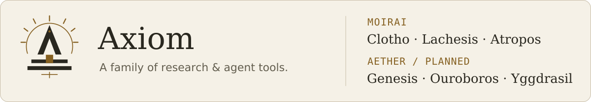

<picture>
  <source media="(prefers-color-scheme: dark) and (max-width: 600px)" srcset="assets/cover-dark-mobile.svg">
  <source media="(max-width: 600px)" srcset="assets/cover-light-mobile.svg">
  <source media="(prefers-color-scheme: dark)" srcset="assets/cover-dark.svg">
  
</picture>

<picture>
  <source media="(prefers-color-scheme: dark) and (max-width: 600px)" srcset="assets/wish-dark-mobile.svg">
  <source media="(max-width: 600px)" srcset="assets/wish-light-mobile.svg">
  <source media="(prefers-color-scheme: dark)" srcset="assets/wish-dark.svg">
  
</picture>

I work on semiconductor measurements and machine learning.

## Featured: Axiom

<picture>
  <source media="(prefers-color-scheme: dark) and (max-width: 600px)" srcset="assets/axiom-celestial-dark-mobile.svg">
  <source media="(max-width: 600px)" srcset="assets/axiom-celestial-light-mobile.svg">
  <source media="(prefers-color-scheme: dark)" srcset="assets/axiom-celestial-dark.svg">
  
</picture>

Axiom is the umbrella brand for the Moirai and Aether series.

**Flagship · Beta:** [**Axiom Chronos**](https://github.com/xinhi6716/axiom-chronos) — codebase workflows with `wish` and `doctor`.

**Moirai** · [**Axiom Clotho**](https://github.com/xinhi6716/ml-super-calculator) — ML integration in progress · **Axiom Lachesis** — planned coordinator, without self-evolution or RAG · [**Axiom Atropos**](https://github.com/xinhi6716/axiom-forge) — available skill pack *(currently Axiom Forge; rename pending)*.

**Aether · planned, not built** · **Axiom Genesis** — research-specialized RSI · **Axiom Ouroboros** — general agent applications / skill self-iteration and evolution · **Axiom Yggdrasil** — database.

## Bookshelf

[CS self-study](https://github.com/xinhi6716/computer-science-self-study) · [English](https://github.com/xinhi6716/computer-science-self-study/blob/main/README.en.md) · [中文](https://github.com/xinhi6716/computer-science-self-study/blob/main/README.md)

---

[Text-only version](README.plain.md)
