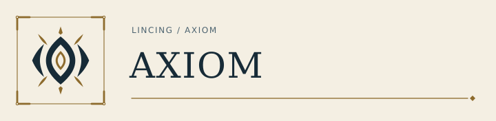
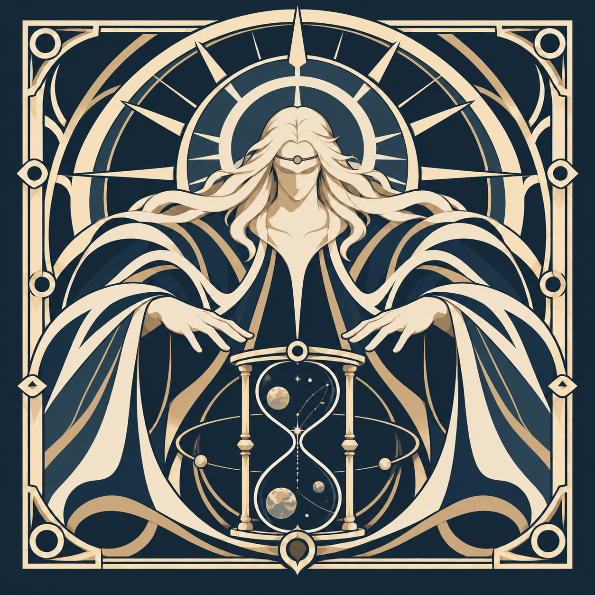
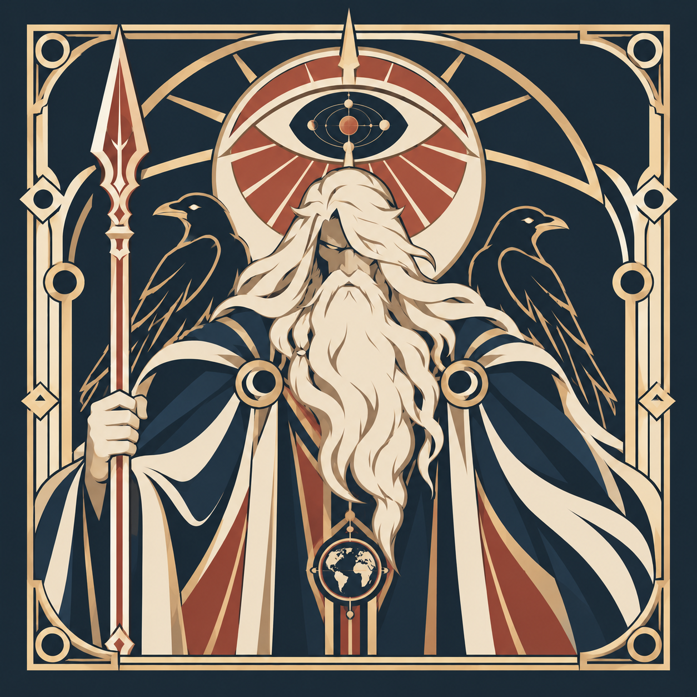
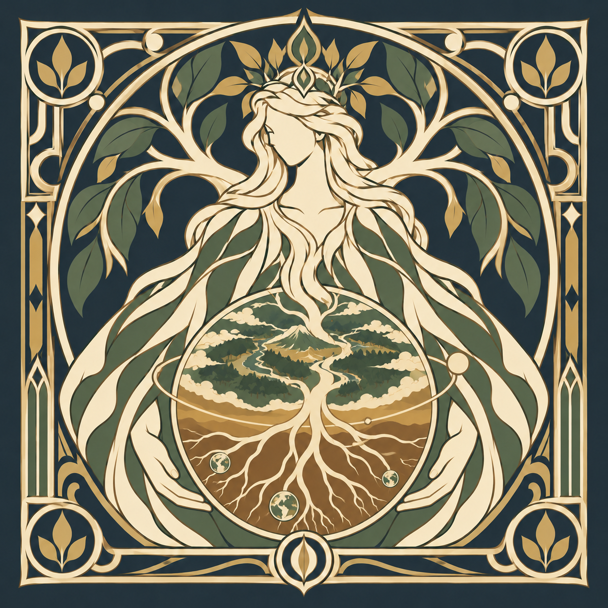
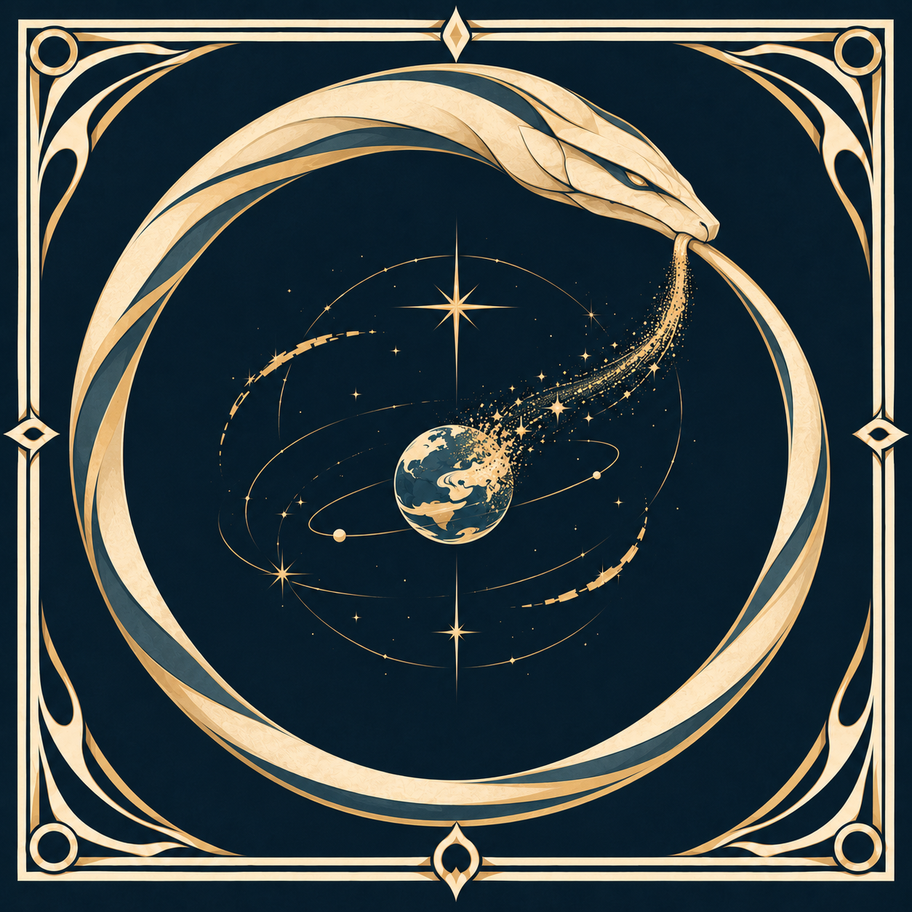

<a href="README.md">English</a> · <a href="README.zh-TW.md">繁體中文</a> · <a href="README.plain.md">純文字</a>

  <picture>
    <source media="(prefers-color-scheme: dark)" srcset="assets/brand-marks/v1/axiom-wordmark-dark.svg">
    
  </picture>

<h1 align="center">LinCing</h1>

半導體量測 · 機器學習

<strong>OpenAI, consider this my very early job application. PhD first.</strong>

  <a href="https://github.com/xinhi6716/axiom-chronos">Chronos</a> ·
  <a href="https://github.com/xinhi6716/axiom-clotho">Clotho</a> ·
  <a href="https://github.com/xinhi6716/axiom-atropos">Atropos</a> ·
  <a href="#personal-library">自學書架</a>

Axiom 將我的專案分成三個系列：Flagship、Moirai 與 Aether。

<h2 id="flagship" align="center">01 · Flagship</h2>

<table>
<tr>
  <td align="center" width="33%"> <a href="https://github.com/xinhi6716/axiom-chronos"><strong>Chronos</strong></a></td>
  <td align="center" width="33%"> <strong>Odin</strong></td>
  <td align="center" width="33%"> <strong>Gaia</strong></td>
</tr>
</table>

<em>All for one.</em> 朝完整代理應用程式與啟動器前進的願景。

<ul>
  <li><strong><a href="https://github.com/xinhi6716/axiom-chronos">Chronos</a></strong> · <a href="https://github.com/xinhi6716/axiom-chronos/releases/tag/v1.0.0">v1.0.0</a> 
    將程式修改需求轉成範圍明確、留下檢查紀錄的工作。從 <code>wish</code> 與 <code>doctor</code> 開始。 
    <a href="https://github.com/xinhi6716/axiom-chronos/blob/main/README.md">English</a> · <a href="https://github.com/xinhi6716/axiom-chronos/blob/main/README.zh-TW.md">繁體中文</a></li>
  <li><strong>Odin</strong> · 概念階段 
    本機 LLM 工作室。</li>
  <li><strong>Gaia</strong> · Coming soon</li>
</ul>

<h2 id="moirai" align="center">02 · Moirai</h2>

<table>
<tr>
  <td align="center" width="33%"> <a href="https://github.com/xinhi6716/axiom-clotho"><strong>Clotho</strong></a></td>
  <td align="center" width="33%"> <strong>Lachesis</strong></td>
  <td align="center" width="33%"> <a href="https://github.com/xinhi6716/axiom-atropos"><strong>Atropos</strong></a></td>
</tr>
</table>

模型、協作，以及完成工作的技能。

<ul>
  <li><strong><a href="https://github.com/xinhi6716/axiom-clotho">Clotho</a></strong> · Beta 
    處理元件量測與分組表格的本機機器學習流程。 
    <a href="https://github.com/xinhi6716/axiom-clotho/blob/main/README.md">English</a> · <a href="https://github.com/xinhi6716/axiom-clotho/blob/main/README.zh-TW.md">繁體中文</a></li>
  <li><strong>Lachesis</strong> · 規劃中 
    多代理協作，不含自我演化或 RAG。</li>
  <li><strong><a href="https://github.com/xinhi6716/axiom-atropos">Atropos</a></strong> · 已提供技能包 
    讓現有代理使用的研究與工程技能。原名 Forge。 
    <a href="https://github.com/xinhi6716/axiom-atropos/blob/main/README.md">English</a> · <a href="https://github.com/xinhi6716/axiom-atropos/blob/main/README.zh-TW.md">繁體中文</a></li>
</ul>

<h2 id="aether" align="center">03 · Aether</h2>

<table>
<tr>
  <td align="center" width="33%"> <strong>Genesis</strong></td>
  <td align="center" width="33%"> <strong>Ouroboros</strong></td>
  <td align="center" width="33%"> <strong>Yggdrasil</strong></td>
</tr>
</table>

<em>規劃中，尚未建成。</em> 三個較長期的方向。

<ul>
  <li><strong>Genesis</strong> 
    專注研究的遞迴自我改進。</li>
  <li><strong>Ouroboros</strong> 
    能持續迭代技能的代理應用程式。</li>
  <li><strong>Yggdrasil</strong> 
    共享資料與知識的基礎。</li>
</ul>

<h2>個人書架</h2>

與 Axiom 分開維護。六科雙語資訊工程講義，另有繁體中文 RRAM 材料與濺鍍入門課程。

<a href="https://github.com/xinhi6716/computer-science-self-study"><strong>CS self-study</strong></a> · <a href="https://github.com/xinhi6716/computer-science-self-study/blob/main/README.en.md">English</a> · <a href="https://github.com/xinhi6716/computer-science-self-study/blob/main/README.md">繁體中文</a>

